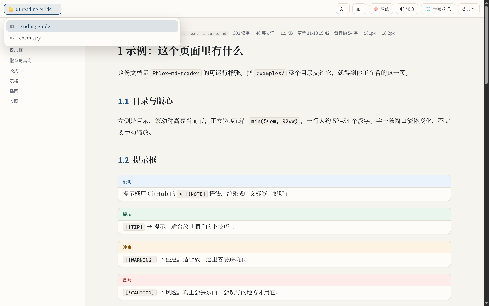
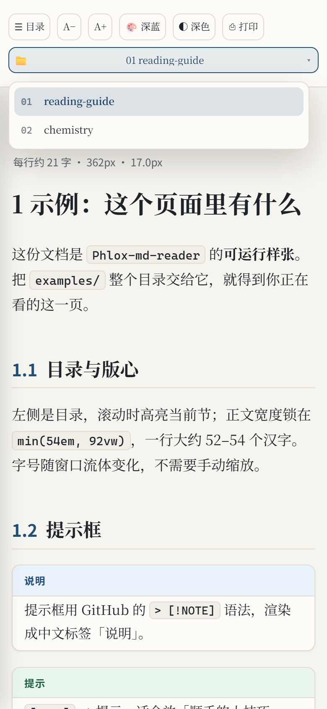
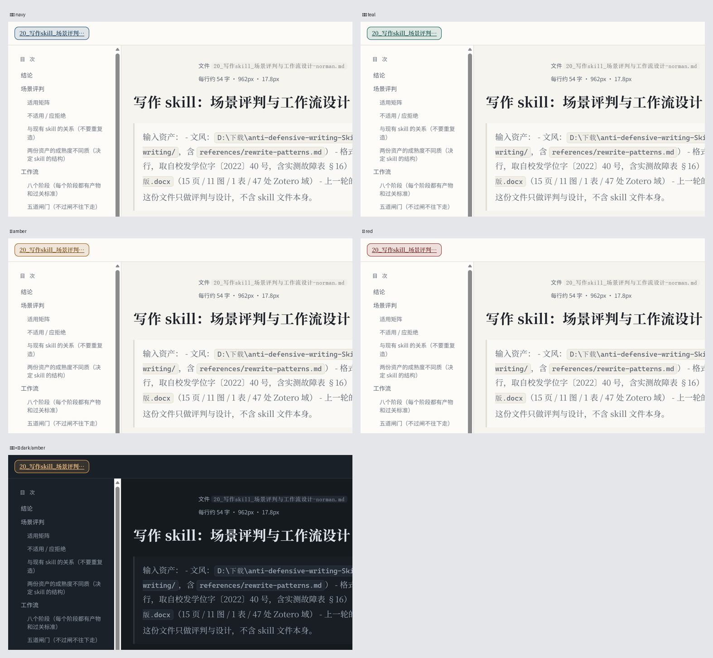
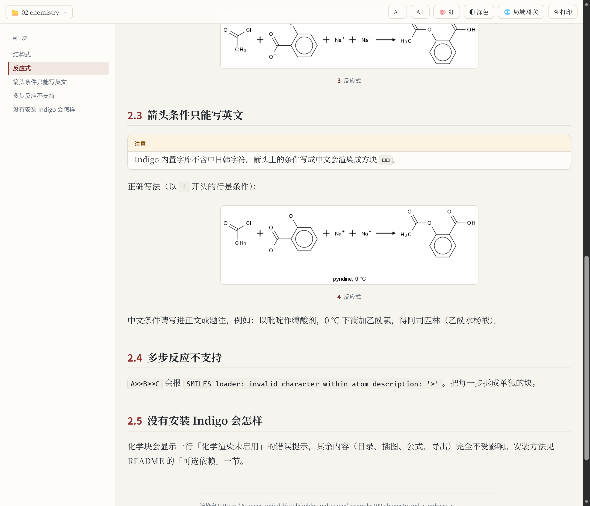

# Phlox-md-reader · Markdown 阅读页

**把 Markdown 渲染成"能长时间读下去"的中文阅读页** —— 一个单文件 Python 工具 + 一个 AI agent skill：左侧目录、自动编号插图、离线公式、SMILES 出化学结构式、深色与四套配色、手机自适应；本地起端口边改边看，也能导出单文件 HTML 发给别人。

[English README](README_EN.md) · [操作说明（给 AI agent）](SKILL.md) · 仓库地址 <https://gitee.com/cric_qin/phlox-md-reader.git>

  



| 手机端（390px） | 四套配色 × 明暗 |
|---|---|
|  |  |

---

## 这是什么

编辑器预览、GitHub 网页、docsify 都只做一件事：**把标记翻译成 HTML**。

但真正的长时间阅读是另一回事。一屏 120 个汉字的长行，读三分钟眼睛就散了；三千字的文档滚到一半找不到自己在哪；贴进去的长截图把整页撑得满屏灰；改一个错别字要手动 F5；想让室友看一眼，对方还得先装个编辑器。

于是有了这个。它不是又一个静态站点生成器，而是一个**只服务"读"**的本地阅读页：你写 md，它负责排版、定位、刷新和分享。

> 目标只有一个：让一份 Markdown 在电脑和手机上，都像一份排版好的 PDF 那样好读——但仍然是活的。

## 效果对照

| 常见做法 | 这里的做法 |
|---|---|
| 一屏 120 字的长行，读三分钟就累 | 版心 `min(54em, 92vw)`，每行 52–54 个汉字，字号 `clamp()` 随窗口流体变化 |
| 长文档找不到位置 | h2/h3 自动加锚点，宽屏固定左栏目录、窄屏 ☰ 抽屉，滚动高亮当前节 |
| 插图没有编号，长截图撑爆一页 | 自动编号 + 题注；高 > 2× 宽的长图进限高 76vh 的滚动框 |
| 化学结构式只能贴 ChemDraw 截图 | ` ```smiles ` 直接出结构式，题注自动补分子式与分子量 |
| 改一个字就要手动刷新 | 800ms 轮询，保存即刷新，且**保留滚动位置** |
| 想发给同学，对方不一定有环境 | `export` 出一份单文件 HTML，图片/公式/字体/样式全内嵌 |

## 快速开始

需要 Python 3.9+（开发与验证环境：Windows 11 + Python 3.13.15）。

```bash
git clone https://gitee.com/cric_qin/phlox-md-reader.git
cd phlox-md-reader
pip install -r requirements.txt      # markdown + pillow
python mdread.py demo                # 先看效果：生成功能样张并打开
```

用在自己的笔记目录上：

```bash
python mdread.py serve "D:\notes"                 # 整个目录，左上角 📁 下拉切换
python mdread.py serve "D:\notes\a.md" --port 7800
```

浏览器自动打开 `http://127.0.0.1:7788/`。改 md 保存 → 页面自己刷新。

### 方式一：当命令行工具用

上面这样直接跑就行。`serve` 边看边改，`build` 存成 html，`export` 打包成单文件。

### 方式二：装成 AI agent 的 skill

如果你在用 DeepSeek Harness 这类带 skill 机制的 agent，把整个目录放进技能目录，之后只要说一句"把这份 md 渲染成网页"，agent 自己会起服务、挑端口、把地址给你：

```bash
cp -r phlox-md-reader ~/.dsh/skills/
```

`SKILL.md` 是写给 agent 看的操作说明（什么时候起服务、什么时候导出单文件、端口被占怎么办、图不显示怎么查），不需要你记命令。

## 五个命令

| 命令 | 用途 |
|---|---|
| `serve <文件或目录>` | 起服务实时预览。选项：`--port`、`--lan on\|off`、`--no-open` |
| `build <文件>` | 渲染成同目录 `xxx.html`，图片走相对路径，双击可看 |
| `export <文件>` | 单文件 HTML，图片/KaTeX 字体/样式全部 base64 内嵌，可发给别人 |
| `doctor` | 自检 KaTeX、Indigo、markdown 库、本机地址、防火墙规则 |
| `demo [目录]` | 生成含图、公式、化学式、提示框的功能样张并起服务 |

端口默认 7788，被占用会自动往后找（+1 … +19），日志里写明实际端口。

## 局域网：默认关闭

服务默认只绑 `127.0.0.1`，外部机器连不上。要手机看，点工具栏的「🌐 局域网 开」——它会**真的重新绑 socket** 到 `0.0.0.0`，然后顶部出现常驻地址条：

```
📶 局域网已开　手机连同一个 Wi-Fi，打开：http://192.168.1.42:7800/　[复制地址] [× 关闭这条]
```

地址条可选中、可一键复制；手机端不显示任何浮层。开关状态存在服务端进程里，**保存 md、切换文档都不会改动它**——你在电脑上改稿，手机那端一直连着。

Windows 首次使用若手机连不上，通常是防火墙：需要给 python 放行入站（端口段 7788–7807）。校园网/公共 Wi-Fi 常做接入层隔离（表现为 `ERR_ADDRESS_UNREACHABLE` 而不是拒连），此时换手机热点最稳。

## 页面里有什么

- **文档切换**：工具栏最左 `📁 当前文档名 ▾`，点开向下列表（编号 + 文件名），当前项高亮，列表滚动位置会被记住。
- **版心与字号**：`html{font-size:clamp(17px,15px+0.22vw,20.5px)}`，右侧实时显示「每行约 N 字 · 正文宽 X px · 字号 Y px」。
- **配色**：`🎨` 循环四套（深蓝 / 青绿 / 琥珀 / 砖红）× `◐` 明暗，记在 localStorage。
- **提示框**：`> [!NOTE]`、`[!TIP]`、`[!IMPORTANT]`、`[!WARNING]`、`[!CAUTION]` → 「说明 / 提示 / 要点 / 注意 / 风险」。
- **徽章**：`【机读】【目视比对】【推断】【待完善】【实测】【结论】` 自动上色。
- **高亮**：`==文字==`。
- **公式**：离线 KaTeX（`$…$`、`$$…$$`），断网可用；导出时字体内嵌。
- **表格**：宽表格横向滑动，不撑破版心。
- **打印**：`⎙` 隐藏工具栏与目录，Ctrl+P 直接存 PDF。



化学能力是**可选**的（另需约 22 MB，Apache-2.0，不随仓库分发）：

```bash
pip install --target vendor epam.indigo
python mdread.py doctor            # 确认 Indigo 可用
```

## 写 md 的三条规矩

1. **反应箭头上的条件只能写英文或符号。** Indigo 内置字库没有 CJK，`! 吡啶, 0 °C` 会渲染成 `□□, 0 °C`：

   ````
   ```rxn
   ! pyridine, 0 °C
   CC(=O)Cl.O=C([O-])c1ccccc1[O-].[Na+].[Na+]>>CC(=O)Oc1ccccc1C(=O)O
   ```
   ````

   中文条件写进正文或题注。多步反应（`A>>B>>C`）也不支持，逐步写多个块。

2. **图片放 `figs/`，用相对路径引用。** 题注就是 alt 文本，写清楚"这是什么"而不是"图片1"；缺图会在日志里以 `[缺图]` 报出。

3. **标题编号自己写**（`## 1 背景`、`### 1.1 现状`）。渲染器会把编号抽成小号强调色，目录也按编号排。

## 适用场景

- **论文精读**：一份 md 里放全文摘录、公式、结构式、对照表，读的时候目录常驻，不用来回滚。
- **组会 / 汇报材料**：先写成 md，现场用平板或手机翻；要发人就 `export` 成单文件。
- **项目交接**：多个 md 放在一个目录，`serve` 后顶部下拉切换，比开五个窗口省事。
- **课程复习**：把笔记按 `00_`、`01_` 编号，考前一天躺着用手机过一遍。
- **给同门发一份**：单文件 HTML，双击就开，不需要装 Python，也不会因为你改了源文件而变化。

## 已知限制

- **没有全文搜索**。文档多时靠编号前缀 + 目录定位。
- 文档列表默认只扫**第一层** `*.md`，不递归（递归会把草稿目录全塞进来）。
- 代码块**没有语法高亮**（不引入 Pygments 依赖）。
- 多步反应式、Mermaid 图不支持。
- KaTeX 的 `$…$` 可能与正文美元符号冲突，必要时用 `$$…$$`。
- 只在 Windows 11 + Python 3.13 上完整验证；Linux/macOS 需自测（防火墙排错说明仅针对 Windows）。

## 依赖与许可

| 组件 | 许可 | 是否随仓库分发 |
|---|---|---|
| 本项目代码 | MIT（见 `LICENSE`） | 是 |
| [KaTeX](https://github.com/KaTeX/KaTeX) 0.16.11 | MIT | 是（`assets/katex/`，附 `LICENSE`） |
| [markdown](https://github.com/Python-Markdown/markdown) | BSD-3-Clause | 否，pip 安装 |
| [Pillow](https://python-pillow.org/) | HPND | 否，pip 安装 |
| [epam.indigo](https://github.com/epam/Indigo) 1.46.0 | Apache-2.0 | **否**，按需 `pip install --target vendor` |

`vendor/` 不存在时化学块被跳过，其余功能不受影响。

## 仓库结构

```
phlox-md-reader/
├── mdread.py              主程序（serve / build / export / doctor / demo）
├── SKILL.md               面向 AI agent 的操作说明
├── install_indigo.py      可选化学依赖的一键安装与自检
├─ assets/katex/          离线 KaTeX 0.16.11
├── examples/              可运行样张（就是上面截图里的内容）
├── docs/                  README 截图
├── references/style.md    设计令牌：配色、字号、断点、间距
└── vendor/                可选依赖（.gitignore 掉，不随仓库分发）
```

## 关于我

这份东西是给自己读文献和写课题材料时顺手做的，踩过的坑都留在 `SKILL.md` 里。

如果你也在用 AI 处理文献、写作和排版，我在小红书 **6987291000** 记录这些工具和流程——工具更新、排版踩坑、还有那些"早知道就好了"的小技巧，都发在那儿。搜这个号就能找到我，欢迎来聊。

> 用得上的话，给个 star；有想加的排版元素，欢迎开 issue 或 PR。也可以直接把你的 md 丢给它跑一遍，遇到奇怪的地方告诉我。