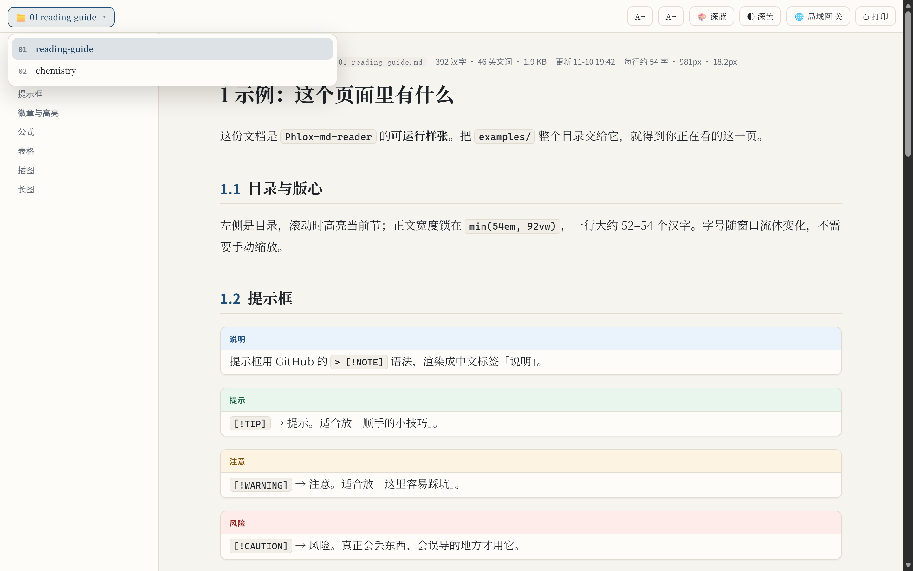
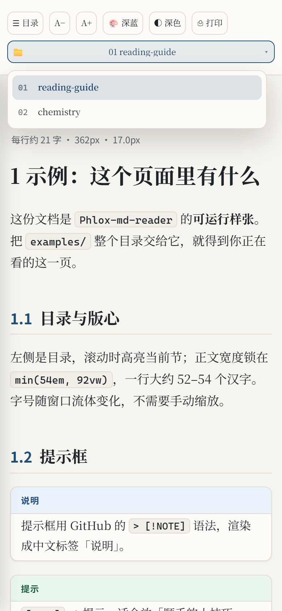
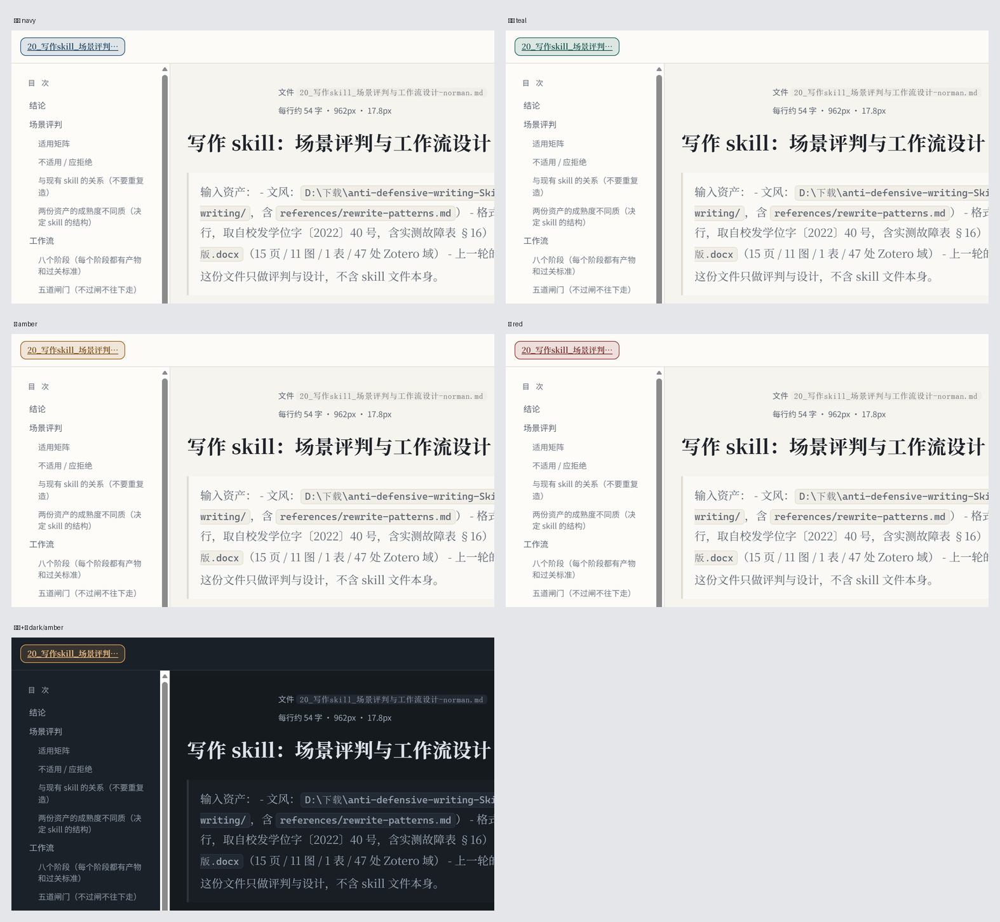

# Phlox-md-reader · a Markdown page made for reading

**Turn a Markdown file into a page you can actually read for an hour.** A single-file Python tool (plus an AI-agent skill): left sidebar table of contents, auto-numbered figures, offline math, chemical structures straight from SMILES, four accent colours with dark mode, mobile layout — live reload on a local port, and a one-file HTML export you can send to a classmate.

[中文 README](README.md) · [Agent instructions](SKILL.md) · Repository <https://gitee.com/cric_qin/phlox-md-reader.git>

  



| Phone (390 px) | Four accents × light/dark |
|---|---|
|  |  |

---

## What this is

Editor previews, GitHub pages and docsify all do one thing: **translate markup into HTML**.

Long-form reading is a different problem. A 120-character line makes your eyes slide off after three minutes; in a 3000-word document you lose track of where you are; one tall screenshot turns the page into a wall of grey; every typo costs a manual F5; and when you want a friend to look, they have to install an editor first.

So this exists. Not another static-site generator — a **local reading page that only cares about reading**. You write Markdown; it handles layout, navigation, reload and sharing.

> One goal: make a Markdown file feel as well-set as a typeset PDF, on desktop and phone — while still being alive.

## How it differs

| The usual | Here |
|---|---|
| 120-character lines, tiring within minutes | Measure locked to `min(54em, 92vw)`, about 52–54 CJK characters per line, font size fluid via `clamp()` |
| Can't find your place in a long doc | Auto anchors on h2/h3; fixed left TOC on wide screens, ☰ drawer on phones, current section highlighted while scrolling |
| Figures unnumbered, tall screenshots blow up the page | Auto numbering + captions; images taller than 2× their width go into a 76vh scroll box |
| Chemical structures = pasting ChemDraw screenshots | A ` ```smiles ` fence renders the structure, and the caption is filled with formula and molecular weight |
| Every typo means a manual refresh | 800 ms polling, save-to-refresh, **scroll position preserved** |
| Sending it to someone needs their setup | `export` produces one HTML file with images, KaTeX fonts and CSS embedded |

## Quick start

Python 3.9+ (built and verified on Windows 11 with Python 3.13.15).

```bash
git clone https://gitee.com/cric_qin/phlox-md-reader.git
cd phlox-md-reader
pip install -r requirements.txt      # markdown + pillow
python mdread.py demo                # generate a feature sample and open it
```

On your own notes:

```bash
python mdread.py serve "D:\notes"                 # whole folder, switch docs from the folder dropdown
python mdread.py serve "D:\notes\a.md" --port 7800
```

Your browser opens `http://127.0.0.1:7788/`. Save the `.md` and the page refreshes itself.

### Way 1 — use it as a CLI tool

As above. `serve` to read while editing, `build` for a static HTML next to the source, `export` for one portable file.

### Way 2 — install it as an AI-agent skill

If your agent supports skills (DeepSeek Harness and friends), drop the folder into the skills directory. After that you just say *"render this md as a page"* and the agent starts the server, picks a free port and hands you the URL:

```bash
cp -r phlox-md-reader ~/.dsh/skills/
```

`SKILL.md` is written for the agent (when to serve, when to export, what to do when the port is taken, how to debug a missing image), so you never have to memorise flags.

## Five commands

| Command | What it does |
|---|---|
| `serve <file or dir>` | Live preview server. Options: `--port`, `--lan on\|off`, `--no-open` |
| `build <file>` | Writes `xxx.html` beside the source; images use relative paths, double-click to open |
| `export <file>` | Single-file HTML with images, KaTeX fonts and CSS inlined as base64 — send it anywhere |
| `doctor` | Checks KaTeX, Indigo, the markdown lib, local IPs and the firewall rule |
| `demo [dir]` | Generates a feature sample (figures, math, chemistry, callouts) and serves it |

Default port is 7788; if it is taken it walks forward (+1 … +19) and logs the real one.

## LAN access is off by default

The server binds `127.0.0.1` only, so nothing else on the network can reach it. To read on your phone, click **🌐 LAN** in the toolbar — it genuinely **rebinds the socket** to `0.0.0.0` and shows a persistent address bar:

```
📶 LAN on — same Wi-Fi, open: http://192.168.1.42:7800/   [copy] [× dismiss]
```

The address is selectable and copyable; no overlay ever appears on phones. The switch lives in the server process, so **saving the md or switching documents never changes it** — keep editing on the desktop while the phone stays connected.

If the phone still can't connect on Windows, it is almost always the firewall: allow inbound TCP for python on ports 7788–7807. Campus and public Wi-Fi often isolate clients (you get `ERR_ADDRESS_UNREACHABLE` rather than a refusal) — a phone hotspot is the reliable workaround.

## What's on the page

- **Document switcher** — `📁 current-doc ▾` at the far left; a numbered dropdown, current item highlighted, list scroll position remembered.
- **Measure and type scale** — `html{font-size:clamp(17px,15px+0.22vw,20.5px)}`; the readout shows "≈N chars/line · width X px · Y px".
- **Colours** — `🎨` cycles four accents (navy / teal / amber / red) and `◐` toggles light/dark; both persisted in localStorage.
- **Callouts** — `> [!NOTE]`, `[!TIP]`, `[!IMPORTANT]`, `[!WARNING]`, `[!CAUTION]`.
- **Badges** — `【机读】【目视比对】【推断】【待完善】【实测】【结论】` get colours automatically.
- **Highlight** — `==text==`.
- **Math** — offline KaTeX (`$…$`, `$$…$$`), works with no network; fonts are inlined on export.
- **Tables** — wide tables scroll horizontally instead of breaking the measure.
- **Print** — `⎙` hides the toolbar and TOC; Ctrl+P gives you a clean PDF.


Chemistry is **optional** (~22 MB, Apache-2.0, not bundled):

```bash
pip install --target vendor epam.indigo
python mdread.py doctor            # confirm Indigo is available
```

## Three rules when writing md

1. **Arrow conditions must be ASCII.** Indigo's built-in fonts have no CJK glyphs, so `! 吡啶, 0 °C` renders as `□□, 0 °C`:

   ````
   ```rxn
   ! pyridine, 0 °C
   CC(=O)Cl.O=C([O-])c1ccccc1[O-].[Na+].[Na+]>>CC(=O)Oc1ccccc1C(=O)O
   ```
   ````

   Put the Chinese conditions in the prose or the caption. Multi-step reactions (`A>>B>>C`) are not supported — use one block per step.

2. **Keep images in `figs/` and reference them relatively.** The caption *is* the alt text, so write what the figure shows, not "image1"; missing files are reported as `[missing image]` in the log.

3. **Number your own headings** (`## 1 Background`, `### 1.1 Current state`). The renderer lifts the number into a small accent-coloured span and sorts the TOC by it.

## Use cases

- **Close reading papers** — one md with excerpts, equations, structures and comparison tables; the TOC stays put so you never scroll-hunt.
- **Lab meeting / progress reports** — write it as md, flip through on a tablet or phone; `export` when someone wants a copy.
- **Project handover** — a folder of md files, switch with the dropdown instead of five editor windows.
- **Exam revision** — prefix notes `00_`, `01_` and read them in bed on your phone the night before.
- **Sending it to a classmate** — a single HTML file, double-click to open, no Python needed, immune to your later edits.

## Known limits

- **No full-text search.** With many documents, rely on numeric prefixes and the TOC.
- The document list scans **top-level** `*.md` only (recursion would drag in every draft folder).
- **No syntax highlighting** in code blocks (no Pygments dependency).
- Multi-step reactions and Mermaid are not supported.
- `$…$` can collide with a literal dollar sign; use `$$…$$` when in doubt.
- Fully verified on Windows 11 + Python 3.13 only; Linux/macOS should work but is untested (firewall advice is Windows-specific).

## Dependencies & licences

| Component | Licence | Bundled? |
|---|---|---|
| This project | MIT (see `LICENSE`) | yes |
| [KaTeX](https://github.com/KaTeX/KaTeX) 0.16.11 | MIT | yes (`assets/katex/`, with its `LICENSE`) |
| [markdown](https://github.com/Python-Markdown/markdown) | BSD-3-Clause | no, via pip |
| [Pillow](https://python-pillow.org/) | HPND | no, via pip |
| [epam.indigo](https://github.com/epam/Indigo) 1.46.0 | Apache-2.0 | **no**, install into `vendor/` on demand |

Without `vendor/`, chemistry blocks are skipped and everything else keeps working.

## Repository layout

```
phlox-md-reader/
├── mdread.py              main program (serve / build / export / doctor / demo)
├── SKILL.md               operating instructions for an AI agent
├── install_indigo.py      optional chemistry dependency, installer + self-check
├── assets/katex/          offline KaTeX 0.16.11
├── examples/              runnable sample (the pages in the screenshots)
├── docs/                  README screenshots
├── references/style.md    design tokens: colours, type scale, breakpoints, spacing
└── vendor/                optional dependency (.gitignored, not shipped)
```

## About me

I built this while reading papers and writing project notes of my own; every trap I hit is written down in `SKILL.md`.

If you also use AI for literature, writing and typesetting, I keep notes on Xiaohongshu (RED) as **6987291000** — tool updates, layout traps, and the small tricks I wish I had known earlier. Search that ID to find me; happy to talk.

> If it saves you a few hours of tuning line width and TOC, a star is appreciated. Ideas for more page elements? Open an issue or a PR — or just throw your own md at it and tell me what looked wrong.