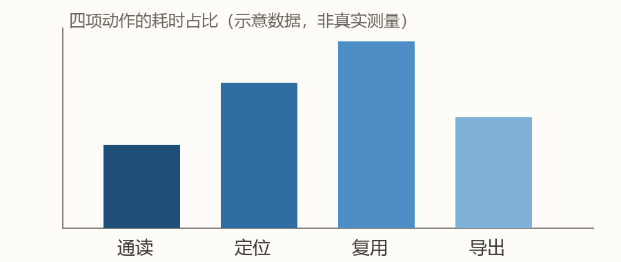
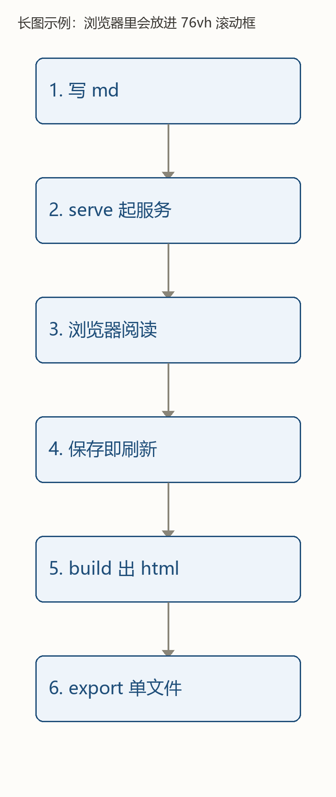

# 1 示例：这个页面里有什么

这份文档是 `Phlox-md-reader` 的**可运行样张**。把 `examples/` 整个目录交给它，就得到你正在看的这一页。

## 1.1 目录与版心

左侧是目录，滚动时高亮当前节；正文宽度锁在 `min(54em, 92vw)`，一行大约 52–54 个汉字。字号随窗口流体变化，不需要手动缩放。

## 1.2 提示框

> [!NOTE]
> 提示框用 GitHub 的 `> [!NOTE]` 语法，渲染成中文标签「说明」。

> [!TIP]
> `[!TIP]` → 提示。适合放「顺手的小技巧」。

> [!WARNING]
> `[!WARNING]` → 注意。适合放「这里容易踩坑」。

> [!CAUTION]
> `[!CAUTION]` → 风险。真正会丢东西、会误导的地方才用它。

## 1.3 徽章与高亮

渲染器会给下面这些词自动上色：`【机读】` 表示可被程序读取的部分，`【目视比对】` 表示必须人眼看的部分，`【推断】` 表示没有直接证据，`【待完善】` 表示还没做完，`【实测】` 表示有实测数据。

`==这一句会被高亮==`，用来在长文里标出真正要记住的那一句。

## 1.4 公式

行内公式：阿司匹林的分子量 $M = 180.16\ \mathrm{g/mol}$，抑制 COX-1 的半数抑制浓度记作 $\mathrm{IC}_{50}$。

独立公式：

$$
K_i = \frac{\mathrm{IC}_{50}}{1 + \frac{[S]}{K_m}}
$$

公式用离线 KaTeX 渲染，断网也能看。

## 1.5 表格

| 用法 | 命令 | 产物 |
|---|---|---|
| 边改边看 | `serve` | 本地端口 + 自动刷新 |
| 存成 html | `build` | 同目录 `xxx.html` |
| 发给别人 | `export` | 单文件 html，全内嵌 |

## 1.6 插图

题注来自图片的 alt 文本，编号由渲染器自动加。**高度超过宽度 2 倍**的长图会被放进限高滚动框，下一页就是例子。

## 1.7 长图

